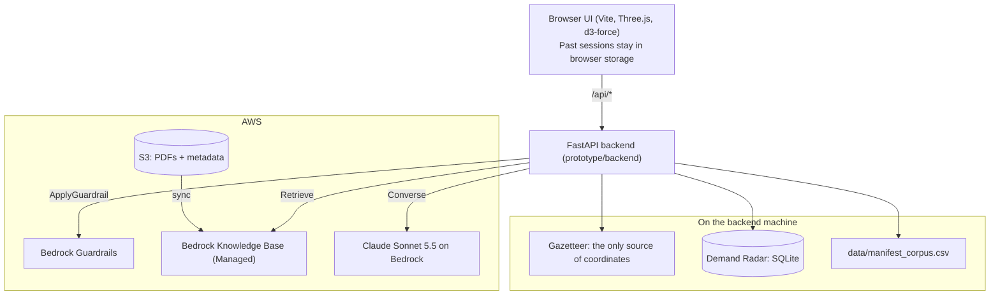
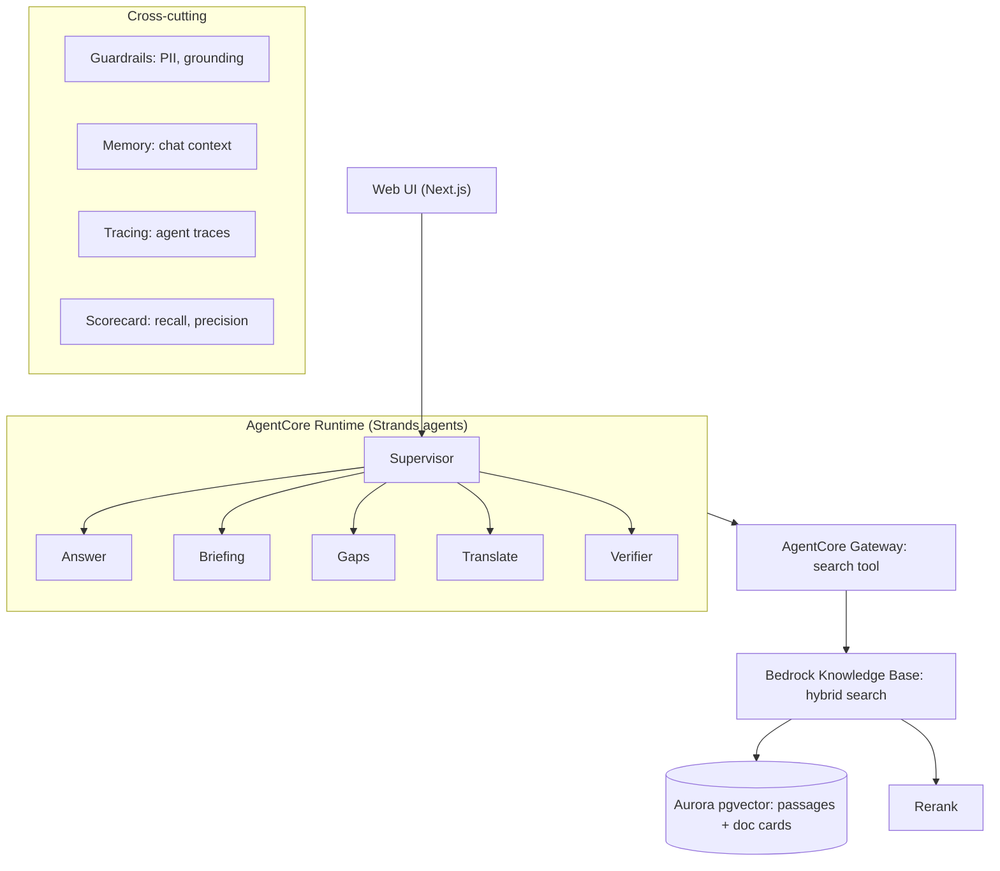
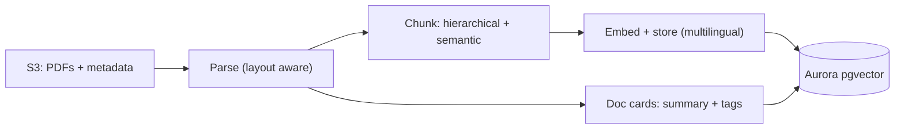

# AskWRI (Team 29)

AWS Breaking Barriers US 2026, World Resources Institute.

AskWRI is a research assistant over WRI publications. It quotes a source passage for every claim, checks each quote word for word against that passage, pins the places the evidence names on a 3D globe, and declines when the sources don't support an answer.

## The problem

A policy analyst, journalist or program officer needs an answer from WRI's research, and WRI has published hundreds of long reports. Searching them by keyword returns documents, not answers. A general chatbot returns answers, but it can invent facts and attach a real-sounding citation to them.

AskWRI answers from WRI publications only. Every claim comes with a quote, and the quote is checked word for word against the source passage. When the sources don't support an answer, it declines. The places the evidence names are pinned on a 3D globe.

## Results

Measured on the real Bedrock Knowledge Base (10 WRI reports), 17 questions (12 answerable, 5 unanswerable), 2 runs each:

| | Before | After tuning |
|---|---|---|
| Answerable questions wrongly refused | 38% | 8% |
| Unanswerable questions correctly declined | 100% | 100% |
| Expected source found (recall) | 58% | 88% |
| Cited sources that were expected (precision) | 100% | 100% |
| Same outcome in both runs | 16/17 | 17/17 |

What changed: retrieve 12 passages instead of 6, tolerant quote matching so PDF noise stops causing false refusals, drop one bad claim instead of refusing the whole answer, and one retry with feedback. The one known remaining miss is question a08. Run `python eval/run_eval_prototype.py` to reproduce. The eval set is small and the corpus is a 10-report subset of the 235 listed in the manifest.

> Status: the globe app in `prototype/` works end to end on real data, running locally. It isn't deployed yet. The agents app in `src/` + `api/` doesn't work against the current Managed Knowledge Base yet. The original design below is kept for reference, and most of it isn't built.

## Architecture



## How it works

1. The input guardrail checks the question and masks personal details. A blocked question stops here and is never logged.
2. The Knowledge Base retrieves passages, and Sonnet 5.5 writes claims, quotes and places as JSON using only those passages. An invalid reply is retried once, then returns a 502.
3. Every quote must appear word for word in its passage (whitespace, hyphenation and quote style are ignored, nothing else). A claim with a quote that doesn't match is dropped and the rest are kept; if none survive, the model is asked once more, then the answer becomes a refusal. Set `QUOTE_MODE=strict` to refuse the whole answer on any mismatch. A pin needs a verified quote that names the place, plus a gazetteer match. A bad place drops only that pin.
4. The output guardrail checks the claims are grounded in the cited passages. Any intervention becomes a refusal.
5. New questions, answered or refused, are logged to Demand Radar with no names.

## Sessions and follow-ups

- **Follow-up box (under the answer):** continues the current session only. The search combines the session's first question, its latest question and the new one, so a request like "place the pinpoints on the map" keeps its subject. Earlier turns are untrusted browser data: each is checked again by the guardrail, and the model is told they're context, never evidence. Quotes must still come from passages retrieved for that turn. Follow-ups aren't logged to Radar.
- **Bottom box (under the globe):** always starts a new chat and moves the old session to Past sessions.
- **Past sessions:** a slide toggle beside Answer. Sessions reopen read-only with their pins. They're kept only in the user's browser, up to 20, with the guardrail-masked question. A blocked question is stored empty.

## Original design (mostly not built)

### Query path



### Ingestion path



### How the original design works

1. The UI sends a question to the supervisor agent, which routes to a specialist (answer, briefing, gaps, translate).
2. Specialists search through one tool (AgentCore Gateway). The knowledge base runs hybrid search on Aurora pgvector, then a rerank model reorders results.
3. The verifier checks each sentence against its cited passage and drops unsupported claims. If too little survives, the answer becomes a decline.
4. Two chunk types serve different jobs: passage chunks for answers and citations, and document cards (summary plus tags) for discovery, coverage and time-aware answers.
5. Every question is logged to Demand Radar (no names), which turns the ones AskWRI can't answer well into a ranked list of what WRI should load or research next.

## Demand Radar

Every question AskWRI can't answer well, from the globe or the agents chat page, is logged, grouped by topic and ranked, at `/radar`. Not every "no answer" means the same thing, so each gap is sorted by who can fix it:

| Gap type | How it's detected | Action |
|---|---|---|
| Not loaded yet | Declined, but the question matches a report in the WRI catalog that isn't in the searchable corpus | Data Lab loads the report |
| Weak coverage | Answered with a low top retrieval score, or declined although the matching report is loaded | Research teams update or extend the work |
| No match in catalog | Declined, and nothing in the catalog matches | Research leadership: possible new research area |

Clusters are ranked by questions × distinct teams × trend (this window vs the previous one). The page filters by gap type, team and language, and exports a "Top 10 gaps" summary as Markdown.

Privacy: no names or user ids are stored, only the question (emails and phone numbers removed), an optional team label and the retrieval outcome. On the globe the stored text is the guardrail-masked question, and blocked questions are never stored. Rows older than `RADAR_RETENTION_DAYS` (default 90) are deleted.

Radar treats everything in `data/manifest*.csv` as loaded. `data/manifest_corpus.csv` lists what's really in the Knowledge Base, and `scripts/build_corpus_manifest.py` rebuilds it, so run that whenever the corpus changes. The Connections map reads the same file, which is how an answer's cited sources get a gold ring.

Current limits:
- **Catalog:** `data/catalog.csv` is a small sample. Replace it with metadata (title, year, program, url) for all WRI reports. No full text is needed.
- **Clustering:** keyword based (TF-IDF), so it can't group questions across languages. Swap in Bedrock multilingual embeddings and one LLM call per cluster for names.
- **Storage:** SQLite (`data/radar.db`). Move to DynamoDB for the deployed version.
- **Demo data:** `scripts/seed_radar.py` adds simulated questions (labelled as simulated on the page). The questions are simulated; the classification and ranking are real.

## Design goals (not all built)

- Cost: small model for verification and tagging, larger model for final answers, cached repeat queries, Aurora Serverless v2 at a low minimum.
- Security: private encrypted S3, least-privilege IAM, PII filters on questions and answers, no identifiers in memory or traces.
- Evaluation: recall and precision against expected sources, plus a check that unanswerable questions are declined.

## Repository layout

```
.env.example        Template for the local .env (see below)
src/askwri/         Strands agents + AgentCore entrypoint, plus Demand Radar (radar, catalog, text)
api/ ui/            Local FastAPI wrapper, simple chat page for the agents, and the /radar page
scripts/            Corpus tooling: build_manifest, build_corpus_manifest, download_corpus, ingest, build_gazetteer, seed_radar
eval/               Evaluation questions and runner
tests/              Demand Radar tests
data/               Manifests, URL lists, Radar's catalog (data/raw/ and radar.db are local only)
prototype/
  backend/          FastAPI service: cited Q&A, map locations, place glances, briefings, graph
  frontend/         Vite + Three.js globe UI with pins, glance cards, sessions and the connection map
security/           Red-team scripts, input precheck (used by the globe backend), corpus integrity checks
.github/workflows/  Security CI: secret scan, static analysis, security tests, dependency audit
infra/              Examples from another account: an S3 HTTPS-only policy (the live bucket has its own) and an unapplied guardrail config
docs/               Setup guides: guardrails-setup.md, knowledge-base-handoff.md (plus WRI.pdf)
```

`src/` + `api/` and `prototype/` are two separate apps that share Demand Radar. `ASKWRI_MOCK=1` runs the agents app without AWS; `DEMO_MODE=true` runs the globe on labeled sample data. The prototype reads `BEDROCK_KB_ID` and `BEDROCK_MODEL_ID` and falls back to `KB_ID` and `MODEL_ID`, so one `.env` holds the values for both. Only the prototype loads the file itself. For `src/askwri`, `scripts/` and `eval/`, load it into your shell first: `set -a; source .env; set +a`.

## Local files that are not in git

These are git-ignored and shared between teammates directly. Put them in these exact locations:

| File | Location | Notes |
|---|---|---|
| `.env` | repo root | Copy `.env.example`. It already selects **Claude Sonnet 5.5** (`us.anthropic.claude-sonnet-5-5`) and starts in `DEMO_MODE=true`. Never put AWS access keys in it. The prototype backend loads it automatically; real environment variables win. |
| `data/raw/` | repo root | PDFs fetched by `scripts/download_corpus.py`. Run scripts from the repo root. |
| `.venv/` | `prototype/backend/` and optionally the repo root | Per-app virtual environments. |
| `node_modules/`, `dist/` | `prototype/frontend/` | From `npm ci` and `npm run build`. |

## Languages

The globe app runs in English, Spanish, Portuguese, French, Indonesian, Hindi and Simplified Chinese, for WRI's offices in Latin America, Brazil, francophone Africa, Indonesia, India and China.

- **Interface:** every label, message and screen-reader text is translated (`prototype/frontend/src/locales/`). The translations are machine drafts: ask a native speaker on the team to review each file before a real launch.
- **Answers:** the backend tells the model to write each claim in the chosen language (`language` on `/api/ask`, `/api/glance`, `/api/briefing`). Quotes are never translated, so the word-for-word quote check still works and readers see the original evidence. Each quote also gets a machine translation for reading, which is never used for verification.
- **Demo:** ask in Spanish and get a Spanish answer backed by quotes from the original English PDF. This needs the live Knowledge Base; sample-data mode answers in English and says so.
- **Checked with real Bedrock:** a Spanish follow-up about Kenya passed the grounding check against English sources. That's one question, not a full test of each language.

## Safety: guardrails and PII

Follow [`docs/guardrails-setup.md`](docs/guardrails-setup.md) to create the Bedrock guardrail (PII masking, off-topic blocking, grounding checks) from [`docs/guardrail.json`](docs/guardrail.json), then put `GUARDRAIL_ID` and `GUARDRAIL_VERSION` in `.env`. Without them the app runs with safety filters off and says so.

`docs/guardrail.json` matches the live guardrail. `infra/guardrail.json` is a separate proposal from the security branch.

**Layers, in the order a question meets them:**

- **Web:** host allowlist, 64 KB body limit, and a rate limit on the routes that spend Bedrock tokens (`hardening.py`). Responses carry a Content-Security-Policy and other security headers. The API map at `/docs` is off.
- **Disguised input:** `security/precheck.py` rejects base64, hex, ROT13 and reversed instructions before any AWS call.
- **Guardrail:** input check, then an output check with grounding at 0.7. If it can't run, the request stops.
- **Model:** answers only from the supplied passages. If its own safety filter declines, that's a refusal.
- **Verification:** every quote must match its passage word for word; each refusal carries a `refusal_reason` (no_sources, model_unanswerable, model_declined, quote_mismatch, grounding).

**Before hosting this anywhere public:** add sign-in, because `/radar` and `/api/radar` are open to anyone who can reach the server, and put HTTPS and an edge rate limit in front of it. The rate limit here is per process, and it sees a load balancer as one client unless the server is set up to trust forwarded addresses. `api/server.py` (the agents app) has none of these web protections, so keep it local.

**If every question returns 503,** the AWS credentials have probably expired. Get new ones and run `aws configure`, or update `~/.aws/credentials`. The guardrail can't run without them, so the app stops rather than answering unchecked.

## Sample data mode

`DEMO_MODE=true` runs the app without a Knowledge Base on invented passages, all titled "SAMPLE", under a permanent banner. They go through the same verification code as real answers. To use real data, follow [`docs/knowledge-base-handoff.md`](docs/knowledge-base-handoff.md) and set `DEMO_MODE=false`.

## Run the agents app locally (no AWS needed)

This is the original chat page in `api/` + `ui/`, with `ASKWRI_MOCK=1` standing in for Bedrock. For the globe, see Setup below.

```bash
pip install fastapi uvicorn pytest httpx
export ASKWRI_MOCK=1                      # keyword search over the manifest titles instead of Bedrock
python scripts/seed_radar.py --reset      # optional: simulated demand for the demo
uvicorn api.server:app --reload           # open http://localhost:8000 and http://localhost:8000/radar
python -m pytest -q tests
```

On Windows PowerShell use `$env:ASKWRI_MOCK = "1"` instead of `export`.

## Setup

(planned) Steps to deploy from this repo.

Run the prototype locally. The virtual environment keeps `pip` and `python` on the same interpreter.

Backend (terminal 1):

```
cd prototype/backend
python3 -m venv .venv
source .venv/bin/activate
python -m pip install -r requirements.txt
python -m uvicorn app:app --reload --port 8001
```

Frontend (terminal 2):

```
cd prototype/frontend
npm ci
npm run dev        # http://localhost:5173
```

Tests: `python -m pytest tests` (Radar), `python -m pytest security/tests`, `cd prototype/backend && python -m pytest`, and `cd prototype/frontend && npm test`.

Real Chrome check, on sample data: start the backend with `DEMO_MODE=true GUARDRAIL_ID= GUARDRAIL_VERSION= RADAR_DB=<absolute path to a throwaway file>`, then run `cd prototype/frontend && npm run build && node tests/e2e-browser.mjs`.
